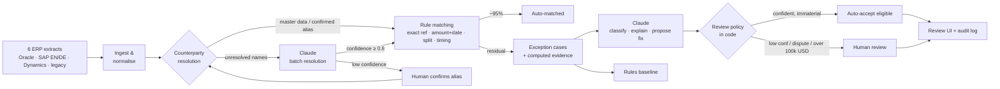

# Intercompany Reconciliation Copilot

**AI Engineer case assignment for NorthStar Infrastructure Group (NIG), a fictional company: Agentic Operations Programme**

NIG has six legal entities running five different finance systems (ERPs). Every month-end, group accountants spend days working out why one entity's intercompany receivable doesn't match the other entity's payable. This prototype automates that work:

- **Deterministic rules** match the routine lines.
- **Claude** classifies, explains and proposes a fix for the exceptions that remain.
- **An accountant** approves every proposal in a review screen, with a full audit trail.

> Cluster: **FIN · Finance**. Status: prototype, evaluation, design document and executive summary done (M1–M5); demo video in progress.

---

## 1. The case at a glance

The brief asks for one painful operational workflow, a working prototype on mock data, and a defence of the engineering and business judgement behind it. Excluded use cases: invoice processing, CV screening, contract review, ticket routing, knowledge chatbots and lead qualification.

**What is evaluated:** engineering judgement, build-vs-buy reasoning, speed of delivery and how realistic the path to production is. Polish is not.

### Deliverables

| Deliverable | Where | Status |
|---|---|---|
| Working prototype (source code or hosted) | this repo: `recon/`, `app.py` | ✅ done |
| Recorded demo, 5–10 min, at least one workflow end-to-end | **VIDEO LINK** (added on submission) | ⏳ recording |
| Technical design document | [docs/technical_design.md](docs/technical_design.md) (+ [evaluation report](docs/evaluation.md)) | ✅ done |
| Executive summary (standalone) | [docs/executive_summary.md](docs/executive_summary.md) | ✅ done |
| Live session: ~30 min presentation and demo, ~30 min Q&A | uses the material above | later |

### The five tasks and where each is answered

| Task | The brief asks for | Answered in |
|---|---|---|
| **1 · Build an operational solution** | A specific, painful workflow from one cluster, automated or augmented. Define the user, the current pain and the future workflow. Mock data must expose the hard parts, not hide them. | Prototype (`recon/`, `app.py`); mock data with deliberate hard cases (`data/README.md`); user and workflow in §2 |
| **2 · Technical design review** | Architecture, tooling, models, integrations, evaluation strategy. Bought vs built and why. What you'd change with more time. How you know it works: quality measures and observed failure cases. | [Design doc §1](docs/technical_design.md#1-architecture-task-2), [evaluation report](docs/evaluation.md); results in §4 |
| **3 · Production readiness** | The work needed to scale across teams, projects and countries: data, security, reliability, cost, operational ownership. An honest effort estimate. | [Design doc §2](docs/technical_design.md#2-production-readiness-task-3): two quarters plus a rollout quarter, gated on three dependencies |
| **4 · Executive summary and demo video** | A 5-minute read for executives burned by AI hype: business value, expected ROI, risks, costs, rollout. Must stand alone. The video may be forwarded without the presenter. | [Executive summary](docs/executive_summary.md) and the demo video |
| **5 · Assumptions and kill test** | The three assumptions the solution depends on most (why each matters, how to validate it, what happens if it's false), plus three shut-down metrics with measurement windows and thresholds. | [Design doc §3](docs/technical_design.md#3-assumptions-and-kill-test-task-5) |

### Milestones

| # | Milestone | Status |
|---|---|---|
| M0 | Choose the use case, user, pain and assumptions | ✅ |
| M1 | Mock data generator: 6 entities, 5 ERP formats, 12 break types, answer key | ✅ |
| M2 | Core pipeline: ingestion, entity resolution, rule matching, LLM classification, evaluation | ✅ |
| M3 | Review UI: queue, case detail, approve/override/escalate, alias confirmation, audit log | ✅ |
| M4 | Evaluation: held-out test set, model comparison and cascade, calibration, failure analysis ([report](docs/evaluation.md)) | ✅ |
| M5 | Technical design document and executive summary | ✅ |
| M6 | Demo: reset and case search in the app, cached demo states, script; recording | ✅ / ⏳ |
| M7 | Fresh-clone check (installs and runs with no API key, all figures reproduce), gap check against the brief, submission | ✅ / ⏳ |

---

## 2. The workflow

**User:** a group accountant on the intercompany reconciliation team, with entity controllers as approvers.

**Why this workflow first:** it recurs every month in every entity, it is caused directly by NIG's acquisition-driven system sprawl, it needs only data every ERP can already export (no months of data engineering), and every break has an objectively right answer, so value can be measured rather than demoed. Alternatives considered and the selection criteria are in the [design doc](docs/technical_design.md#0-problem-and-context-assumptions).

**Today:** every month each entity exports its intercompany balances from its own ERP. Exports differ in format, language, date convention and how they identify partner entities. Accountants match lines in spreadsheets, then chase the leftovers across time zones by email: FX differences, timing, wrong partner codes, typos, duplicates, withholding tax, disputes. Breaks delay the group close and some get written off unexplained.

**With the copilot:**

1. The extracts are ingested and normalised automatically.
2. Rules match about 95% of transactions. Each match has a stated rule and confidence that can be audited.
3. Each remaining exception arrives as a **case**. It already holds the evidence (computed differences, FX rate comparisons, tax ratios, duplicate checks), a classification, a plain-language explanation and a proposed correcting entry.
4. The accountant works a prioritised queue. Low-confidence, disputed or material cases are always routed to a person. Every decision is logged.
5. Partner names the system couldn't resolve with confidence are confirmed once and added to the reference data, so the system needs the model less each month.



---

## 3. Key design choices

- **Rules first, the LLM only for the remainder.** Matching is deterministic, free and explainable. The model sees about 15% of lines.
- **Code computes, the model reasons.** Every difference, rate comparison and pattern check is calculated in Python and passed to the model as evidence. The model never does arithmetic.
- **Human oversight is enforced in code, not in the prompt.** The review policy (confidence < 0.75, disputes, amounts > $100k) is deterministic and auditable.
- **A rules baseline runs beside the model.** It sets the bar the LLM has to beat to justify its cost, and it is the fallback if the API is unavailable.
- **Model answers are cached and versioned.** Cache keys include the model, prompt version and input. Answers are committed, so the demo and evaluation replay without an API key or any cost.
- **Bought vs built:** the model (Claude Opus 5.5 via the Anthropic API, structured outputs) and the UI framework (Streamlit) are bought; the domain logic is built: matching rules, evidence, review policy and evaluation. Full reasoning is in the design document.

---

## 4. Results (mock October 2026 close)

Scored against the generator's answer key. There are two datasets:

- **development** (seed 42): used while building
- **held-out** (seed 2027): an independent test, scored after all fixes

Full analysis is in **[docs/evaluation.md](docs/evaluation.md)**.

| Metric | Rules only (no model) | Rules + Claude Opus 5.5, held-out | Development |
|---|---|---|---|
| Match precision (auto-matches that are correct) | 100% | **100%** (245/245) | 100% |
| Auto-matchable transactions matched | 83% | **96%** | 93% (98% after 2 name confirmations) |
| Real breaks surfaced as a case | 100% | **100%** (102/102) | 100% |
| Exception classification accuracy | 96% | **99.0%** (101/102; 95% CI 94.7–99.8) | 100% |
| Accuracy of cases auto-accepted without review | n/a | **100%** (85/85) | 100% |
| Cases routed to a human | 100% | **21%** | 27% |
| Model cost per monthly run | $0 | **$2.55** (≈ $0.02 per case) | $2.62 |

- **Model choice.** Opus, Sonnet and Haiku 5.5 all classify at 98–100%. Opus sends half as many cases to people as Sonnet, and reviewer time costs far more than tokens. **Recommended:** a Haiku-then-Opus cascade. It matches Opus's accuracy with the lowest review rate, at 47–64% lower cost.
- **Failures found and fixed.** The evaluation surfaced six defects in the pipeline itself, including reference matching that silently never worked for 2 of 6 entities. Most model "errors" were upstream bugs that the model had flagged as suspicious.
- **Honest caveat.** On this synthetic data, a hand-written rules classifier is close behind the model, because the break types are known in advance. The model's measured value lies in resolving partner names, explanations, correcting entries and routable confidence. Its value on unanticipated real-world breaks is the first thing the pilot must prove.

---

## 5. Run it

Requires Python 3.11 or later. An API key is **optional**: without one, the committed model answers are replayed.

```bash
python -m venv .venv
# Windows: .venv\Scripts\activate     macOS/Linux: source .venv/bin/activate
pip install -r requirements.txt

python -m recon.run            # pipeline + evaluation -> out/
streamlit run app.py           # review UI at http://localhost:8501
```

| Command | What it does |
|---|---|
| `python data_gen/generate_mock_data.py` | Regenerate the mock data (seed 42, deterministic) |
| `python -m recon.run --no-llm` | Never call the API; replay cached answers only |
| `python -m recon.run --limit 5` | At most 5 new API calls (smoke test) |
| `python -m recon.run --prune-cache` | Remove cached answers the current run no longer uses (careful: also drops other datasets/models answers) |
| `python -m recon.experiments` | Model comparison (Opus / Sonnet / Haiku), calibration, threshold sweep, cascade |
| `RECON_DATA=data_holdout RECON_OUT=out_holdout python -m recon.run` | Run on the held-out set (generate it first with `--seed 2027 --out data_holdout`) |

To make live model calls, put `ANTHROPIC_API_KEY=...` in a `.env` file in the project root (it's gitignored). The model and effort can be changed with `RECON_MODEL` and `RECON_EFFORT`.

On Windows PowerShell, set the environment variables first: `$env:RECON_DATA="data_holdout"; $env:RECON_OUT="out_holdout"; python -m recon.run`.

---

## 6. Repository layout

```
data_gen/generate_mock_data.py   mock data + answer key generator
data/raw/                        6 ERP extracts + manifest (what the pipeline sees)
data/reference/                  entity master data (deliberately incomplete aliases), FX rates
data/ground_truth/               answer key - read only by recon/evaluate.py
recon/
  ingest.py      per-ERP schema config -> canonical line table
  entities.py    counterparty resolution (master data -> confirmed aliases -> Claude)
  match.py       deterministic matching rules
  cases.py       exception cases + computed evidence
  classify.py    Claude structured-output classification, rules baseline, review policy
  llm.py         API wrapper: structured outputs, disk cache, cost tracking
  review.py      decisions + append-only audit log
  evaluate.py    scoring against the answer key
  experiments.py model comparison, calibration, threshold sweep, cascade
  run.py         CLI / pipeline entry point
app.py           Streamlit review UI
cache/llm/       committed model answers (reproducible demo)
docs/            technical design, executive summary, evaluation report
```

All company, people and transaction data is fictional and generated by `data_gen/`.
