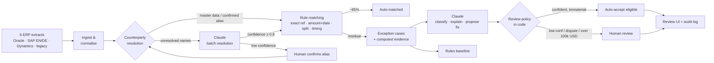

# Intercompany Reconciliation Copilot

**AI Engineer case assignment for NorthStar Infrastructure Group (NIG), a fictional company: Agentic Operations Programme**

NIG has six legal entities running five different finance systems (ERPs). Every month-end, group accountants spend days working out why one entity's intercompany receivable doesn't match the other entity's payable. This prototype automates that work:

- **Deterministic rules** match the routine lines.
- **Claude** classifies, explains and proposes a fix for the exceptions that remain.
- **An accountant** approves every proposal in a review screen, with a full audit trail.

> Cluster: **FIN · Finance**. Status: working prototype (M1–M3 done); the documents and demo video are in progress.

---

## 1. The case at a glance

The brief asks us to choose one painful operational workflow, build a working prototype on mock data, and defend the engineering and business judgement behind it. Excluded use cases: invoice processing, CV screening, contract review, ticket routing, knowledge chatbots and lead qualification.

**What is evaluated:** engineering judgement, build-vs-buy reasoning, speed of delivery and how realistic the path to production is. Polish is not.

### Deliverables

| Deliverable | Where | Status |
|---|---|---|
| Working prototype (source code or hosted) | this repo: `recon/`, `app.py` | ✅ done |
| Recorded demo, 5–10 min, at least one workflow end-to-end | link added here | ⏳ M6 |
| Technical design document | `docs/technical_design.md` | ⏳ M5 |
| Executive summary (standalone) | `docs/executive_summary.md` | ⏳ M5 |
| Live session: ~30 min presentation and demo, ~30 min Q&A | uses the material above | later |

### The five tasks and where each is answered

| Task | The brief asks for | Answered in |
|---|---|---|
| **1 · Build an operational solution** | A specific, painful workflow from one cluster, automated or augmented. Define the user, the current pain and the future workflow. Mock data must expose the hard parts, not hide them. | Prototype (`recon/`, `app.py`); mock data with deliberate hard cases (`data/README.md`); user and workflow in §2 |
| **2 · Technical design review** | Architecture, tooling, models, integrations, evaluation strategy. Bought vs built and why. What you'd change with more time. How you know it works: quality measures and observed failure cases. | `docs/technical_design.md`; evaluation harness `recon/evaluate.py`; current results in §4 |
| **3 · Production readiness** | The work needed to scale across teams, projects and countries: data, security, reliability, cost, operational ownership. An honest effort estimate. | `docs/technical_design.md`, production section |
| **4 · Executive summary and demo video** | A 5-minute read for executives burned by AI hype: business value, expected ROI, risks, costs, rollout. Must stand alone. The video may be forwarded without the presenter. | `docs/executive_summary.md` and the demo video |
| **5 · Assumptions and kill test** | The three assumptions the solution depends on most (why each matters, how to validate it, what happens if it's false), plus three shut-down metrics with measurement windows and thresholds. | `docs/technical_design.md`, assumptions and kill-test section |

### Milestones

| # | Milestone | Status |
|---|---|---|
| M0 | Choose the use case, user, pain and assumptions | ✅ |
| M1 | Mock data generator: 6 entities, 5 ERP formats, 12 break types, answer key | ✅ |
| M2 | Core pipeline: ingestion, entity resolution, rule matching, LLM classification, evaluation | ✅ |
| M3 | Review UI: queue, case detail, approve/override/escalate, alias confirmation, audit log | ✅ |
| M4 | Evaluation deep-dive: failure analysis, cost and model comparison | ⏳ |
| M5 | Technical design document and executive summary | ⏳ |
| M6 | Demo video | ⏳ |
| M7 | Submission | ⏳ |

---

## 2. The workflow

**User:** a group accountant on the intercompany reconciliation team, with entity controllers as approvers.

**Today:** every month each entity exports its intercompany balances from its own ERP. Exports differ in format, language, date convention and how they identify partner entities. Accountants match lines in spreadsheets, then chase the leftovers across time zones by email: FX differences, timing, wrong partner codes, typos, duplicates, withholding tax, disputes. Breaks delay the group close and some get written off unexplained.

**With the copilot:**
1. The extracts are ingested and normalised automatically.
2. Rules match about 95% of transactions. Each match has a stated rule and confidence that can be audited.
3. Each remaining exception arrives as a **case**. It already holds the evidence (computed differences, FX rate comparisons, tax ratios, duplicate checks), a classification, a plain-language explanation and a proposed correcting entry.
4. The accountant works a prioritised queue. Low-confidence, disputed or material cases are always routed to a person. Every decision is logged.
5. Partner names the system couldn't resolve with confidence are confirmed once and added to the reference data, so the system needs the model less each month.



---

## 3. Key design choices

- **Rules first, the LLM only for the remainder.** Matching is deterministic, free and explainable. The model sees about 15% of lines.
- **Code computes, the model reasons.** Every difference, rate comparison and pattern check is calculated in Python and passed to the model as evidence. The model never does arithmetic.
- **Human oversight is enforced in code, not in the prompt.** The review policy (confidence < 0.75, disputes, amounts > $100k) is deterministic and auditable.
- **A rules baseline runs beside the model.** It sets the bar the LLM has to beat to justify its cost, and it is the fallback if the API is unavailable.
- **Model answers are cached and versioned.** Cache keys include the model, prompt version and input. Answers are committed, so the demo and evaluation replay without an API key or any cost.
- **Bought vs built:** we buy the model (Claude Opus 5.5 via the Anthropic API, structured outputs) and the UI framework (Streamlit). We build the domain logic: matching rules, evidence, review policy and evaluation. Full reasoning is in the design document.

---

## 4. Current results (mock October 2026 close)

Measured with `python -m recon.run` against the generator's answer key: 344 transactions, 701 ledger lines, 90 real breaks.

| Metric | Rules only | Rules + Claude |
|---|---|---|
| Match precision (auto-matches that are correct) | 100% | **100%** (249/249) |
| Auto-matchable transactions matched | 88% | **95%** (100% after 2 human alias confirmations) |
| Breaks surfaced as a case | 100% | **100%** (90/90) |
| Exception classification accuracy | 87% | **95%** (87/92) |
| Accuracy of cases eligible for auto-accept | n/a | **97%** (72/74) |
| Cases routed to a human | 100% | **27%** (28/105) |
| Model cost per monthly run | $0 | **≈ $3** (Opus 5.5; ≈ $0.03 per case) |

**Known weak spots:**
- Withholding tax: the model gets 90% and the rules get 93%.
- An amount-only matching false positive, observed and fixed: a net-of-tax amount coincided with another invoice's gross amount.
- Partner names the model rightly refused to guess.

Details and analysis will follow in the design document.

---

## 5. Run it

Requires Python 3.11 or later. An API key is **optional**: without one, the committed model answers are replayed.

```bash
python -m venv .venv
# Windows: .venv\Scripts\activate     macOS/Linux: source .venv/bin/activate
pip install -r requirements.txt

python -m recon.run            # pipeline + evaluation -> out/
streamlit run app.py           # review UI at http://localhost:8501
```

| Command | What it does |
|---|---|
| `python data_gen/generate_mock_data.py` | Regenerate the mock data (seed 42, deterministic) |
| `python -m recon.run --no-llm` | Never call the API; replay cached answers only |
| `python -m recon.run --limit 5` | At most 5 new API calls (smoke test) |
| `python -m recon.run --prune-cache` | Remove cached answers the current run no longer uses |

To make live model calls, put `ANTHROPIC_API_KEY=...` in a `.env` file in the project root (it's gitignored). The model and effort can be changed with `RECON_MODEL` and `RECON_EFFORT`.

---

## 6. Repository layout

```
data_gen/generate_mock_data.py   mock data + answer key generator
data/raw/                        6 ERP extracts + manifest (what the pipeline sees)
data/reference/                  entity master data (deliberately incomplete aliases), FX rates
data/ground_truth/               answer key - read only by recon/evaluate.py
recon/
  ingest.py      per-ERP schema config -> canonical line table
  entities.py    counterparty resolution (master data -> confirmed aliases -> Claude)
  match.py       deterministic matching rules
  cases.py       exception cases + computed evidence
  classify.py    Claude structured-output classification, rules baseline, review policy
  llm.py         API wrapper: structured outputs, disk cache, cost tracking
  review.py      decisions + append-only audit log
  evaluate.py    scoring against the answer key
  run.py         CLI / pipeline entry point
app.py           Streamlit review UI
cache/llm/       committed model answers (reproducible demo)
docs/            design document + executive summary (M5)
```

All company, people and transaction data is fictional and generated by `data_gen/`.
